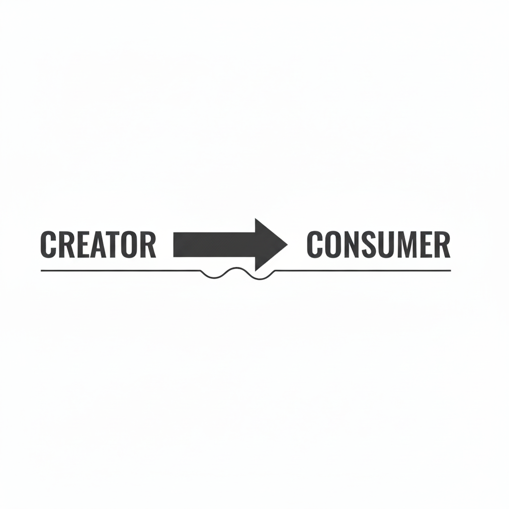
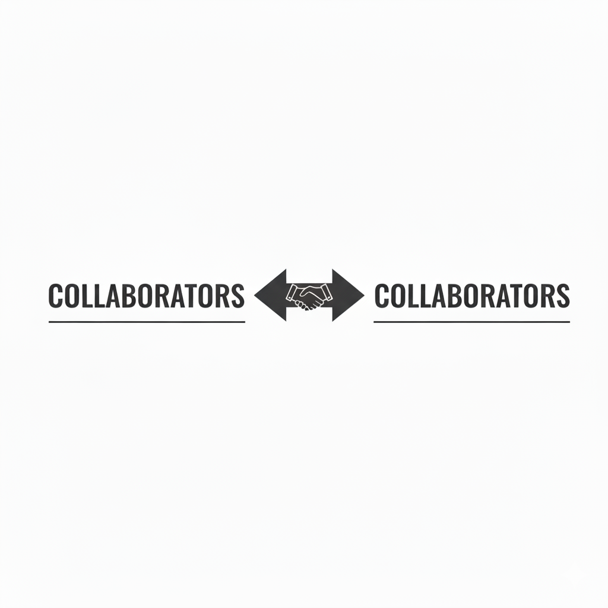
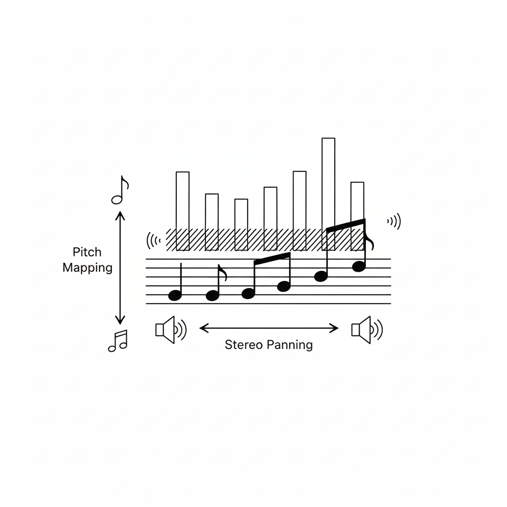
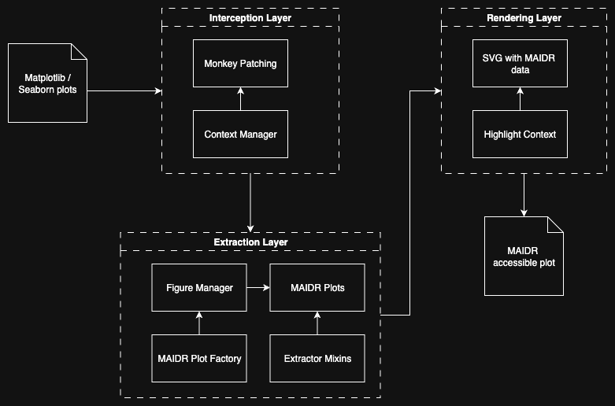

---
# The page's own title, which the deck had none of (a screen reader read the
# file name, "slides"). A title: would add a title slide.
pagetitle: "Data (In)sight for All: Multimodal Chart Exploration with MAIDR"
# AccessComputing Partner Meeting, October 23, 2026, 11:00 Pacific / 13:00 Central.
# Approximately 15 minutes plus Q&A. Full ProSem deck retained for reuse.
# Prioritize framing, modalities, one Python/R example, and the Claude.ai demo.
# Optional detail: Python box plot, Shiny implementation, architecture, R layers.
format:
  revealjs:
    # FIXME: Remove once the Quarto that renders this deck has
    # quarto-dev/quarto-cli#15020. With history on, reveal.js navigates again to
    # each horizontal slide it has just written into the URL, so screen readers
    # announce the first five slides, the deck's only horizontal ones, twice
    # (quarto-dev/quarto-cli#15019). The URL still follows the slides, but the
    # browser's Back button no longer steps through them.
    history: false
    # Keep Esc from opening the thumbnail grid during screen-reader navigation.
    # Disable only Reveal's overview; Esc can still dismiss menus and overlays.
    overview: false
    width: 1600
    height: 900
    margin: 0.02
    center: false
    minScale: 0.1
    maxScale: 3
    theme: night
    slide-tone: true
    scrollable: false
    embed-resources: false
    center-title-slide: true
    code-line-numbers: false
    code-copy: true
execute:
  echo: false
  cache: false
  # A fresh kernel for every render. Quarto keeps a document's kernel alive for
  # five minutes, and a second render within that time starts where the first
  # ended: with maidr imported. maidr takes over matplotlib's backend, so the
  # plain figure on "It Sounds Like This..." is then not drawn on its slide,
  # stays open, and the first chart is drawn on top of it.
  daemon: false
jupyter: python3
include-in-header:
  - text: |
      <link rel="stylesheet" href="slides.css?v=20261023-accesscomputing1">
      <script src="slides.js"></script>
---

## Data (In)sight for All: Multimodal Chart Exploration with MAIDR


**JooYoung Seo**\
*School of Information Sciences, University of Illinois Urbana-Champaign*

AccessComputing Partner Meeting, October 23, 2026

::: {.notes}
Thank you, Brianna, and thanks to the AccessComputing partners for having me. Today I want to talk about a barrier many of us encounter in computing education and research: charts that assume everyone can see.

In about fifteen minutes, I will introduce a shared multimodal approach and show how to use it through Python, R, and an AI assistant. The examples are meant for the same classrooms, research groups, and communities that AccessComputing and AccessSTEM support. Then I look forward to your questions.
:::

---


## Let's Think...

> What good is a chart you **can't see**?

> How do you read a **chart** you can't **see**?


::: {.notes}
All right, let's jump right in. We're going to talk about data. You know, it's pretty much the engine behind everything these days. Business, science, you name it. And we usually understand data through things like charts and graphs. They're like a universal language. But what happens when you can't see that language? No, really, think about that. We rely so much on just glancing at a chart and seeing the pattern, right? A spike here, a dip there. So how on earth are you supposed to get any meaning out of a bar chart or a scatter plot if you can't actually see it?
:::

---

## Data Viz Divide {.data-viz-divide-slide}

> **A Picture's Worth...?**

::: columns
::: {.column width="50%"}
### For Sighted Users

- **Instant insight**
- **Visual patterns** at a glance
- **Effortless** data comprehension
:::

::: {.column width="50%"}
### For Users with Visual Impairments

- **Wall** of inaccessible data
- **Locked door**, with valuable information **trapped** inside
- **Barriers** to understanding
:::
:::

::: {.notes}
Well, this is the divide. For a sighted person, a chart gives you that instant insight, right? The trends, the weird outliers, they just pop. But for blind and low vision users, that exact same chart can be a total dead end. It's a wall. It completely locks them out of the entire data conversation.
:::

---

## "Design for Them" Approach {.design-for-them-slide}

::: columns
::: {.column width="50%"}
- Sighted person to create a chart and then add a separate description as an afterthought

- One group *produces* **boundaries** while the other group just *consumes*

- **One-way street:** power imbalance
:::

::: {.column width="50%"}
{alt="A bold horizontal arrow points from the word CREATOR on the left to the word CONSUMER on the right, both in large capital letters. The arrow sits above a thin horizontal line that connects the two words, with a small bracket underneath the arrow. The overall tone is direct and emphasizes a one-way flow of information from creator to consumer, highlighting a sense of separation and power imbalance."}
:::
:::

::: {.notes}
for those who cannot see it. I am sorry, but that's their issue.

This quote just nails the real problem, doesn't it? See, for the longest time, the approach to accessibility has been what you might call design for them. A sighted person makes a chart and then, almost as an afterthought, a separate, often clunky text description gets added for blind and low vision or BLV users. It creates this one-way street, this power imbalance where one group is basically dictating the entire experience for another.
:::

---

## Shifting to "Design for Us" {.design-for-us-slide}

::: columns
::: {.column width="50%"}
### "For Them"

- **Unidirectional**, separate tools, one group dictates
- **One-way street**
- **Exclusionary** design approach
:::

::: {.column width="50%"}
### "For Us"

- **Bidirectional**, unified framework, all users collaborate
- **Two-way conversation**
- **Inclusive** design approach
:::
:::

{fig-align="center" alt="Two groups labeled COLLABORATORS face each other from opposite sides of the image, connected by a double-headed arrow with a handshake icon in the center. A horizontal line runs beneath each group, visually linking them. The design emphasizes mutual cooperation and equal partnership, with a tone that is inclusive and collaborative. The background is clean and minimal, focusing attention on the concept of shared effort. Text in the image: COLLABORATORS (on both sides)."}

::: {.notes}
And this slide just lays it all out, side by side. The old way, the 'for them' way, that's the one-way street we talked about. Separate tools, separate experiences, with the sighted creator basically calling all the shots. But this new 'for us' way, well, that's a two-way conversation. It's about creating a single unified framework where everyone, sighted and BLV users, can work together on the exact same visualization, just using different senses to perceive it. It's a huge difference.
:::


# Meet {maidr}!

{fig-align="center" width="300px" alt="MAIDR logo"}

> **Data Insight for All.**

::: {.notes}
And that's what brings us to the solution. It's a bridge, and it's called maidr. And what's so cool about it is that it's not just a tool, it's a whole new way of thinking. It's a shift from design for them to design for us.
:::

---

## What is {maidr}? 🔎

- Multimodal Access and Interactive Data Representation

- Decoupling vision-first approach from data interpretation

- Encode **data representation** in multiple modalities

- **Not** a separate, watered-down version for blind users

- **one unified experience**: the same information with **preferred modalities**

::: {.notes}
And this really gets to its whole reason for being, its motto: Data Insight for All. The goal here isn't to make some separate watered-down version for blind users. Nope. It's about creating one unified experience that lets everybody work with the exact same information together.

It is open source, and it grew out of my IMLS Early Career project. Today it is a family of packages for R, Python, and JavaScript, with more than 119,000 downloads.
:::

---

## Multimodal Data Representation

On top of visualization:

- **Touchable (Braille)** 🖐️

- **Readable (Text)** 📖

- **Audible (Sonification)** 🎶

- **Conversable (AI)** 💬

::: {.notes}
The visual stays exactly as you designed it. On top of it, the same plot becomes what we call multimodal. And that just means a user can interact with it in all these different ways. They can explore it on a refreshable braille display, they can read it as simple text, they can hear the data points as musical tones, that's sonification, and they can even ask it questions with a built-in AI chat. Let me take them one at a time.
:::

---

## Touchable: Feel Data 🖐️

- Data shape and trend pattern in **Unicode Braille symbols**

- Users can run their fingers across the data to **feel** its **peaks** and **valleys**

- With a **refreshable braille display**, or as a **tactile graph** on a Dot Pad or a Monarch

::: {.notes}
First up, making data touchable. Maidr can represent a whole plot using braille symbols on what's called a refreshable braille display. So a user can literally run their fingers across the data and feel its shape, its peaks, its valleys.

And on a multiline tactile display, such as the Dot Pad or the Monarch, the plot itself is raised in pins: a tactile graph.
:::

---

## It Feels Like This... {.feels-slide}
{.nostretch alt="A box plot showing life expectancy by continent with braille display device, demonstrating accessible data visualization"}

::: {.notes}
This is a box plot of life expectancy by continent. Above it is the same box plot as one line of braille, and in the photo a hand is reading that line on a refreshable braille display. Each kind of dot pattern stands for a part of the box: the whiskers, the box, the median, the outliers. Read it left to right and you feel where the data is spread out and where it is packed together.
:::

---

## Audible: Listen to Data 🔊 {.audible-slide}
::: columns
::: {.column width="55%"}

- **Sonification** turns data into **audible tones**

- x-axis value: **stereo panning** position

- y-axis value: **pitch**

- As a trend goes up, a musical pitch rises with it

:::
::: {.column width="45%"}

{alt="Diagram illustrating how data is mapped to sound for sonification. Musical notes are shown on a staff, with vertical bars above each note representing data values. Arrows indicate pitch mapping from data values to musical notes and stereo panning from left to right speakers. The diagram includes icons for sound and music, and the text Pitch Mapping and Stereo Panning. The overall tone is informative and technical, showing how data trends can be experienced through audio."}

:::
:::

::: {.notes}
But touch is just the beginning. It also uses something called sonification, which is just a fancy word for turning data into sound. Imagine you're tracking a trend line. As the line goes up, a musical pitch goes up with it. You could literally hear the data.
:::

---

## It Sounds Like This... {.sounds-slide}

::: columns
::: {.column width="55%"}
```{python}
#| echo: false
#| fig-align: center
#| fig-alt: "A scatter plot showing a strong positive relationship between x and y. The x-axis ranges from 0 to 10, and the y-axis ranges from approximately 5 to 35. Data points are scattered closely around a straight line that slopes upwards from left to right, indicating that as x increases, y also increases."

import numpy as np
import matplotlib.pyplot as plt

np.random.seed(0)
x = np.linspace(0, 10, 30)
y = 3 * x + 5 + np.random.normal(0, 3, size=x.shape)

# Simple linear regression fit
m, b = np.polyfit(x, y, 1)
y_hat = m * x + b

plt.figure(figsize=(6, 4))
plt.scatter(x, y, color="#4C78A8", alpha=0.85, label="Data")
plt.plot(x, y_hat, color="#F58518", linewidth=2.5, label=f"Fit: y={m:.2f}x+{b:.2f}")
plt.title("Strong Positive Relationship")
plt.xlabel("x")
plt.ylabel("y")
plt.legend()
plt.subplots_adjust(top=0.90, right=0.98, left=0.10, bottom=0.12)
```
:::

::: {.column width="45%"}

<audio controls preload="metadata" style="width:100%" aria-label="Sonification of the strong positive relationship">
  <source src="./audios/positive-correlation.wav" type="audio/wav" />
</audio>

:::
:::

::: {.notes}
Play the audio. It is five seconds.

That is a scatter plot with a strong positive relationship. You heard the pitch climb as the sound moved from your left ear to your right. Nobody had to tell you the trend goes up.
:::

---

## Readable: Understand Data 📖

- A straightforward **text** of the plot's key features

- Get a clean, simple summary of what the plot is showing

::: {.notes}
And of course there is a simple text mode. Each point you land on is read out with its axis labels and its value, and one key gives you a description of the whole plot.
:::

---

## Conversable: Chat with Data 💬

- **Powered by AI/LLMs** (GPT, Gemini, Claude)
- **Ask questions** and get **co-insight** of the plot
- **Natural language** data analysis

- **Example Query** Can you summarize the main trend for me?

::: {.notes}
Now, this fourth mode is straight out of science fiction. Maidr actually plugs into conversational AIs: GPT, Gemini, Claude. This means you can just talk to the chart. You can literally ask it questions like, "Hey, what's the highest value here?" or "Can you summarize the main trend for me?" It's like having a data analyst built right into the visualization.
:::


# Beyond Theory: {maidr} in Action!

{fig-align="center" width="300px" alt="MAIDR logo"}

::: {.notes}
Beyond theory: maidr in action. Let's cut to the chase.
:::

---

## One Engine, Three Ways In

- **Python:** `import maidr` with Matplotlib, Seaborn, Plotly, or Altair

- **R:** `library(maidr)` with ggplot2 or base R graphics

- **AI assistants:** the maidr skill for Claude and ChatGPT

- Each one hands your plot **and its data** to the same engine, **maidr.js**

::: {.notes}
Here is the map for the next fifteen minutes. Three ways in, depending on how you make your plots: Python, R, or an AI assistant that writes the code for you.

Whichever door you take, the same thing happens. Your plot goes out as you drew it, and the data behind it travels along. One engine, maidr.js, turns that into sound, braille, text, and conversation. So what you learn on the first chart works on all the others.
:::

---

## Keyboard-Toggle Modalities

| Key | Function |
| :--- | :--- |
| `Arrow Keys` | Move around the plot |
| `B` | Toggle Braille Mode |
| `T` | Toggle Text Mode |
| `S` | Toggle Sonification Mode |
| `D` | Open Plot Description |
| `Page Up` / `Page Down` | Switch Layers |
| `?` | Open Chat AI Mode |

::: {.notes}
And the best part, it's all driven by the keyboard. You're in complete control. Users can just use the arrow keys to move from data point to data point. And then with a single key press, they can switch modes. B for braille, T for text, S to hear the sonification. D gives a description of the whole plot, Page Up and Page Down move between the layers of a plot, and the question mark opens the AI chat. It puts the user right in the driver's seat.
:::

---

## Python: Just Plug In

```{python}
#| eval: false
#| echo: true

# Step1: Import
import maidr #<<

import matplotlib.pyplot as plt

# Step2: Create a plot
plt.bar(['A', 'B', 'C'], [1, 2, 3])

# Step3: Show with maidr
maidr.show() #<<
```

::: {.notes}
Python first. And when I say plug in, I am not kidding. The simplicity here is honestly what makes it so powerful. To make your plot multimodal, you write your normal plot code. Then you add one line, `import maidr`, and finally, instead of the old `plt.show()`, you just use `maidr.show()`. That's it. Two tiny changes to your code.
:::

---

## Python: Multiline Plot

```{python}
#| include: false
#| eval: true

from pathlib import Path

import numpy as np
import matplotlib.pyplot as plt
import maidr
import maidr.util.iframe_utils as maidr_frames
import pandas as pd
from htmltools import HTML, TagList
from IPython.display import display
from maidr.util.iframe_utils import wrap_in_iframe_matplotlib

# FIXME: Remove once py-maidr gives its chart frames an allowlist that holds on
# a page opened from disk (xability/py-maidr#910). From 1.27.0 the deck's
# Python charts are written into the page and need none of this, but the
# frame show_saved_chart builds below still gets allow="bluetooth; serial;
# hid", and a feature named there without an allowlist goes to the frame's
# 'src' origin alone. On a file: page nothing matches that, so Chrome denies
# the frame Bluetooth, USB and HID, and maidr.js, which asks the policy first,
# greys out every way to a tactile display: the deck then reaches one only
# when it is served from localhost. 'self' is the page the frame is on, and
# holds on both; 'src' keeps what py-maidr meant.
maidr_frames._ALLOWED_FEATURES = (
    "bluetooth 'self' 'src'; serial 'self' 'src'; hid 'self' 'src'"
)

# Charts load maidr.js from the CDN, pinned to the newest release, which
# py-maidr looks up when the deck is rendered (xability/py-maidr#889), rather
# than carrying its 2 MB bundle in the page. `include: false` keeps whatever
# `import maidr` writes in this cell off the slide.
maidr.set_use_cdn(True)


def show_saved_chart(file, title, width=760, extra_css=""):
    """Put a chart page saved outside this deck on a slide.

    The R charts (charts/make_r_charts.R) and the AI assistant's chart
    (charts/ai-accesscomputing-partners.html) are pages of their own: this kernel
    runs no R, and the assistant's answer is shown as it came back. Each goes
    into the frame py-maidr builds for a notebook chart, which slides.css
    styles as a card. The pages already pin the newest maidr.js, as the Python
    charts do. extra_css is added to the page, for one that holds more than
    its chart.

    FIXME: wrap_in_iframe_matplotlib is py-maidr's own frame, not part of its
    public API. Revisit when the maidr pin in requirements.txt moves.
    """
    page = Path(file).read_text(encoding="utf-8")
    # A saved page fills its window, and R maidr fits the chart to it. Here the
    # frame takes its size from the chart, so the chart is given a width.
    fit = f"""<style>
      html, body {{ width: auto !important; height: auto !important; margin: 0 !important; }}
      .maidr-page {{ display: block !important; min-height: 0 !important; width: auto !important; padding: 0 !important; }}
      svg[maidr], svg[maidr-data] {{ width: {width}px !important; height: auto !important; max-width: none !important; max-height: none !important; }}
      {extra_css}
    </style>"""
    page = page.replace("</head>", fit + "</head>", 1)
    display(wrap_in_iframe_matplotlib(TagList(HTML(page)), title))


# Load gapminder directly via pandas
url = "https://raw.githubusercontent.com/plotly/datasets/master/gapminder_unfiltered.csv"
gapminder = pd.read_csv(url)

# Pick a country and sort by year
country = "United States"
dfc = gapminder[gapminder["country"] == country].sort_values("year")

x = dfc["year"]
life_exp = dfc["lifeExp"]
gdp_k = dfc["gdpPercap"] / 1000.0
pop_m = dfc["pop"] / 1_000_000.0

# Index all series to the first year (base = 100)
base_year = int(x.iloc[0])
life_idx = ((life_exp / life_exp.iloc[0]) * 100.0).round(2)
gdp_idx = ((gdp_k / gdp_k.iloc[0]) * 100.0).round(2)
pop_idx = ((pop_m / pop_m.iloc[0]) * 100.0).round(2)

# Create the complete plot (but don't display it)
plt.figure(figsize=(6, 4))
lineplot = plt.plot(x, life_idx, "bo-", label="Life expectancy index", linewidth=2, markersize=6)
plt.plot(x, gdp_idx, "rs--", label="GDP per capita index", linewidth=2, markersize=6)
plt.plot(x, pop_idx, "g^:", label="Population index", linewidth=2, markersize=6)
plt.title(f"{country}: Indexed trends (base {base_year}=100)")
plt.xlabel("Year")
plt.ylabel("Index")
plt.legend()
plt.tight_layout()
plt.subplots_adjust(top=0.90, right=0.98, left=0.10, bottom=0.12)
plt.close()  # Close the matplotlib figure to prevent display
```

```{python}
#| echo: true
#| eval: true
#| output-location: slide

import maidr #<<

plt.plot(x, life_idx, "bo-", label="Life expectancy index")
plt.plot(x, gdp_idx, "rs--", label="GDP per capita index")
plt.plot(x, pop_idx, "g^:", label="Population index")
plt.xlabel("Year")
plt.ylabel("Index")

maidr.show() #<<
```

::: {.notes}
A real one. Three lines for the United States since 1950: life expectancy, GDP per capita, and population, each indexed to 100 in the first year. The two highlighted lines are all that maidr adds.

(Next slide, the plot itself. Tab moves into it. Right arrow walks the years, and the pitch follows the line. Up arrow changes lines: population, then GDP per capita. T turns text on, B braille, S sound. Shift and Tab return to the slides.)
:::

---

## Python: Box Plot {.box-plot-slide}

```{python}
#| echo: false
#| eval: true

# FIXME: Remove after xability/py-maidr#911 is fixed and rechecked.
# Keep the installed package untouched; patch only while this slide renders.
# Seaborn's inverted Y axis otherwise makes Up move visually down.
from charts.boxplot_order_workaround import install_box_order_workaround
restore_box_order = install_box_order_workaround()

import matplotlib.pyplot as plt
import seaborn as sns
import maidr
import pandas as pd

# Load gapminder and filter for 2007 data
url = "https://raw.githubusercontent.com/plotly/datasets/master/gapminder_unfiltered.csv"
gm = pd.read_csv(url)
df2 = gm[(gm["year"] == 2007) & (gm["continent"].isin(["Africa", "Europe"]))].copy()
df2["gdp_k"] = df2["gdpPercap"] / 1000.0

# Create the complete plot
plt.figure(figsize=(6, 4))
ax = sns.boxplot(
    x="gdp_k", y="continent", data=df2, order=["Africa", "Europe"], palette=["#4C78A8", "#F58518"], showfliers=True
)
plt.title("GDP per capita (2007, k$): Africa vs Europe")
plt.xlabel("GDP per capita (thousands $)")
plt.ylabel("Continent")
plt.subplots_adjust(top=0.90, right=0.98, left=0.10, bottom=0.12)
plt.close()
```

```{python}
#| echo: true
#| eval: true
#| output-location: slide
import maidr #<<


sns.boxplot(
    x="gdp_k", y="continent", data=df2,
    order=["Africa", "Europe"],  showfliers=True
)

plt.xlabel("GDP per capita (thousands $)")
plt.ylabel("Continent")

maidr.show() #<<
```

::: {.notes}
Same two lines, now with Seaborn: GDP per capita in 2007, Africa above Europe, as a box plot.

(Next slide. Tab in. Right arrow moves through one box: from the lower outliers and the minimum, through 25%, 50%, and 75%, to the maximum and the upper outliers. Up arrow goes from Europe to Africa; Down arrow returns from Africa to Europe. B shows the braille, the kind of pattern on the "It Feels Like This" slide.)
:::

---

## {Shiny} + {maidr} integration

```{python}
#| include: false
#| eval: true

# The boxplot-only workaround must not affect later chart demonstrations.
restore_box_order()
```

```{python}
#| eval: false
#| code-line-numbers: false
#| echo: true
# Minimal Shiny-for-Python app structure with MAIDR-ready plots
from shiny import App, ui

# UI with tabs mirroring slides
app_ui = ui.page_fluid( # implement ui.navset_tab with tabs mirroring slides
)

@output
@render_maidr #<<
def create_histogram_output():
    ax = ...  # build matplotlib/seaborn axes
    return ax

app = App(app_ui, server)
```
Source: [xability/a11y_dashboard](https://github.com/xability/a11y_dashboard)

::: {.notes}
Plots do not only live in notebooks and slides. In a Shiny dashboard, one decorator, render_maidr, turns each plot the dashboard draws into the same multimodal chart, and it stays that way as the reader changes the inputs.
:::

---

## maidr Shiny Dashboard

```{=html}
<div style="margin: 0 auto; width: 100%; max-width: 1400px; height: 85vh;">
  <iframe
    src="https://xabilitylab.shinyapps.io/a11y_dashboard/"
    title="MAIDR Shiny Dashboard"
    style="display:block; width:100%; height:100%; border:0; border-radius: 8px;"
    loading="lazy"
    allow="bluetooth; serial; hid; clipboard-write; encrypted-media; fullscreen; picture-in-picture">
  </iframe>
</div>
```

::: {.notes}
And this is a dashboard built that way, live on shinyapps.io: histogram, box, scatter, bar, line, heatmap, multiline, multilayer and multipanel plots, and one you design yourself. Every plot in it is a maidr chart, so the same keys work: pick a tab, Tab into the plot, and use the arrows.

(Live: the app can take a few seconds to wake, and a tab's chart a few more to appear. Tab moves into the dashboard; Shift+Tab, a few times, comes back to the slides.)
:::

---

## The Magic behind the Scenes {.architecture-slide}

{alt="A flowchart of how maidr turns a Matplotlib or Seaborn plot into an accessible one, in three layers. Matplotlib and Seaborn plots go into the Interception Layer, which holds Monkey Patching and, feeding it, a Context Manager. From there an arrow leads down to the Extraction Layer, where a MAIDR Plot Factory feeds a Figure Manager, the Figure Manager feeds MAIDR Plots, and Extractor Mixins feed MAIDR Plots too. The Extraction Layer leads to the Rendering Layer, where a Highlight Context feeds an SVG with MAIDR data. The output of the Rendering Layer is the MAIDR accessible plot."}

::: {.notes}
So, you're probably wondering, what's the trick? How do two lines of Python pull this off? It's a really clever three-step dance, and it happens in a split second. I love the analogy that it's like a simultaneous translator for data. First, maidr intercepts the command to create a plot. Then it pulls out all the important bits: the data, the structure, what kind of chart it is. And finally, it injects those accessible layers right into the plot before it ever gets displayed. Totally seamless.

The R package takes the same three steps for ggplot2 and base R graphics, and R is where we go next.
:::

---

## R: One Line

```r
library(maidr) #<<
library(ggplot2)

ggplot(mpg, aes(class)) +
  geom_bar(fill = "steelblue") +
  labs(title = "Cars by class", x = "Class", y = "Number of cars")
```

::: {.notes}
Now R. Here it is one line: `library(maidr)`. After that, any ggplot you print opens as a multimodal plot. Nothing else in your code changes.

This is the mpg data that ships with ggplot2: how many cars there are in each class.
:::

---

## R: One Line

```{python}
#| echo: false
#| eval: true

show_saved_chart("charts/r-bar.html", "Cars by class", width=680)
```

::: {.notes}
Same keys as in Python. Tab into the plot, then the arrow keys: seven bars, from two-seaters to SUVs. B for braille, T for text. Shift and Tab bring me back to the slides.
:::

---

## R: Layers

```r
library(maidr) #<<
library(ggplot2)

ggplot(mpg, aes(hwy, after_stat(density))) +
  geom_histogram(bins = 15, fill = "steelblue") +
  geom_density(linewidth = 1) +
  labs(title = "Highway fuel economy",
       x = "Highway miles per gallon", y = "Density")
```

::: {.notes}
Plots are often more than one layer. This one puts a density curve over a histogram of highway fuel economy. Still one line of maidr.
:::

---

## R: Layers

```{python}
#| echo: false
#| eval: true

show_saved_chart("charts/r-hist-density.html", "Highway fuel economy", width=680)
```

::: {.notes}
Tab in. The arrow keys walk the bins of the histogram. Page Up moves to the next layer, the density curve, and now the arrows follow the curve: listen to it rise and fall. Page Down takes me back to the histogram.
:::

---

## AI: Ask Your Assistant

- AI assistants hand you plots as **pictures**: nothing to hear, touch, or explore

- The **maidr skill** teaches them to make **every** plot multimodal

- It picks Python, R, or JavaScript for you, and **checks its own work**

- For **Claude** and **ChatGPT**, and for Codex, Cursor, GitHub Copilot, and Gemini CLI

::: {.notes}
And the third way in. Many of you no longer write plotting code at all. You ask Claude or ChatGPT for a plot, and what comes back is a picture. To me, that is the same wall all over again.

So we wrote a skill. A skill is a set of instructions an AI assistant loads when the task calls for it. Ours teaches the assistant to make every plot it draws multimodal, whether or not you ask. It picks Python, R, or JavaScript to match your project, and it checks its own work before it hands the plot over.
:::

---

## AI: One-Time Setup

- **Claude Code:** `/plugin marketplace add xability/maidr-skill` then `/plugin install maidr@maidr-skill`

- **ChatGPT.com:** [Download the ready-made ZIP](https://github.com/xability/maidr-skill/releases/download/main-skill/maidr-skill.zip), then **Plugins → Skills → Add → Upload**

- **Claude.ai:** upload the same ZIP in **Customize → Skills → Add** and turn it on

- **Any coding agent:** `npx skills add xability/maidr-skill`

::: {.notes}
You install it once. For the web apps, download our ready-made ZIP and upload it as a skill, not as a chat attachment. In ChatGPT, this requires a plan or workspace with Skills enabled; both the Illinois workspace and the personal Pro account used in this rehearsal have it. In Claude, enable code execution and turn the skill on. No one needs to clone the repository or build a ZIP. The public plugin directory submissions are not the same thing: Claude is still in review, and current OpenAI approval has not been confirmed. Claude Code can use the third-party marketplace commands on the slide. All of this is documented with official sources in the README of xability slash maidr-skill.
:::

---

## AI: Just Ask for a Plot {.prompt-slide}

```default
Chart the number of AccessComputing partners in each partner category
from https://accesscomputing.uw.edu/partners.
```

::: {.notes}
Here is an example from this community, rather than from our own university: the partner network that brings institutions, organizations, and industry together. This is the same original prompt used in Claude.ai and the personal ChatGPT demo. It asks for a chart and identifies the public source; it does not provide any numbers.

In this rehearsal, Claude.ai's workspace had web search disabled, and its code sandbox could not fetch the source domain. I therefore supplied counts checked against the official roster: 77 Institutional Partners, 29 Organizational Partners, and 17 Industry Partners, captured October 20, 2026. These are partner-category memberships, not student counts or program impact measures.

The first exported chart used Chart.js without a MAIDR binding. A follow-up explicitly requested the installed maidr skill and genuine Python binding output. Keep both follow-ups in the conversation when presenting this example: do not claim that this run fetched the data or automatically activated the skill from the first prompt. The full prompt history and source notes are saved under demo/.
:::

---

## AI: What Came Back

```{python}
#| echo: false
#| eval: true

show_saved_chart(
    "charts/ai-accesscomputing-partners.html",
    "AccessComputing partners by category, October 20, 2026",
)
```

Claude.ai · [Open the original demo](https://claude.ai/chat/fbab7127-b46d-4112-8978-bf115b7f7f4d){target="_blank" rel="noopener noreferrer"} (presenter login)

::: {.notes}
This is the chart exported by Claude.ai, not a replacement drawn outside the conversation. The original conversation opens in a new tab and requires the presenter's signed-in Claude.ai account.

The bars represent listed entries in the three official partner categories: Institutional 77, Organizational 29, Industry 17. They sum to 123 category memberships. Teach Access is listed in both Organizational and Industry Partners, so that is 122 unique partners, not 123. The chart preserves that overlap note and credits the official roster. This is a snapshot, not a historical trend or a claim about student outcomes.

Tab into the chart and use the arrow keys to explore. T toggles text, B braille, and S sound. Physical braille hardware and screen-reader audio were not tested in this browser rehearsal. Use the exported HTML in this slide if the live conversation is unavailable. The MAIDR runtime still loads from a CDN, so an internet connection is required.
:::

---

## AI: ChatGPT Public Demo

```{python}
#| echo: false
#| eval: true

show_saved_chart(
    "charts/ai-accesscomputing-partners-chatgpt.html",
    "AccessComputing partners by category, generated in ChatGPT",
)
```

ChatGPT · [Shared chat history](https://chatgpt.com/share/6ad7e7d2-aa08-83e9-90ae-7031a1231ceb){target="_blank" rel="noopener noreferrer"} · [Open chart (no login)](charts/ai-accesscomputing-partners-chatgpt.html){target="_blank" rel="noopener noreferrer"}

::: {.notes}
This is a second run of the same one-line prompt, in a personal ChatGPT Pro account with the MAIDR skill installed. ChatGPT fetched the official partner roster itself, counted partner entries rather than named contacts, identified the Teach Access overlap, and generated a real py-maidr chart. It did not need the counts supplied in a follow-up as the Claude.ai rehearsal did. The counts are Institutional 77, Organizational 29, and Industry 17.

This slide preserves ChatGPT's generated SVG, MAIDR data binding, and bundled runtime, with only an outer HTML wrapper and source/overlap notes added for presentation. The original file preview passed keyboard and braille checks. After a delivery-only follow-up, the same chart also rendered inside the conversation: Tab entered the MAIDR application, arrows announced 77, 29 and 17, and every highlight matched its original bar. All three values and highlights were checked at actual inline frame widths of 360, 390 and 778 CSS pixels, without horizontal overflow; the full ChatGPT mobile layout was not emulated. B displayed the braille shape. Physical braille hardware, screen-reader audio, and data-dependent sonification in the actual ChatGPT frame remain untested.

The original response printed a bare visualize call instead of rendering the chart. A follow-up corrected the native publication syntax without redrawing it. The new public link includes that complete history and the corrected inline chart; its read-only shared view passed Tab and all three arrow-key/value/highlight checks while signed in. Do not claim that the initial one-line response already rendered inline. A fresh anonymous browser opened the shared conversation without login, but the inline result instead said "Code execution is disabled for this workspace." The signed-in check is not proof of anonymous chart execution. The converter, guidance and regression tests were corrected in upstream maidr-skill PR #41, which is submitted but not merged. Use the direct interactive chart link or this embedded copy for reliable no-login public interaction. The exported bundle works without downloading maidr.js; its UI begins in English, settings are session-local, and its AI chat is unavailable.
:::

---

## But Does It Work With...? {.works-with-slide}

**119,000+** downloads across CRAN, PyPI, and npm

- **Python:** Matplotlib, Seaborn, Plotly, Altair

- **R:** ggplot2, base R graphics

- **JavaScript:** D3, Plotly.js, Vega-Lite, Observable Plot, Chart.js, Highcharts, ECharts, Google Charts, amCharts, AnyChart, ApexCharts, Frappe Charts, uPlot, TradingView Lightweight Charts, React, Recharts, Victory, Nivo, MUI X Charts

- **BI and Office:** Tableau, Power BI, Excel, PowerPoint, Word

- **Where you work:** terminal, Jupyter Notebook, Google Colab, Quarto, Shiny, Streamlit, web pages

- **AI assistants:** agent skill and MCP server, for Claude and ChatGPT

::: {.notes}
So, does it work with the tool you use? Probably. Python and R you have seen. On the web there are adapters for nineteen JavaScript libraries, from D3 and Plotly to Google Charts. It reads embedded Tableau dashboards, Power BI visuals, and the charts in Excel, PowerPoint, and Word. It runs wherever you work: the terminal, Jupyter, Colab, Quarto, Shiny, Streamlit, or a plain web page. And for AI assistants there is the skill you just saw, plus an MCP server.

Together, the packages have been downloaded more than 119,000 times.
:::

# A Future We Build Together {.future-slide}

::: {.notes}
But look, this is about more than just a single tool. This is about a bigger vision. It's about a fundamental shift in how we think about our community and our work. It's about building a future that we can all be a part of.
:::

---

## Data Insight for All {.data-insight-slide}

**Pick your way in:**

```default
# Python
pip install -U maidr

# R
install.packages("maidr")

# AI assistants
npx skills add xability/maidr-skill
```

::: {.notes}
Three ways in, three lines. Pick the one that matches how you work, and try it on a plot from your own research this week.
:::

---

## Learn More & Contribute

-   **Start here:** [maidr.ai](https://maidr.ai)

-   **Python:** [py.maidr.ai](https://py.maidr.ai)

-   **R:** [r.maidr.ai](https://r.maidr.ai)

-   **AI skill:** [github.com/xability/maidr-skill](https://github.com/xability/maidr-skill)

-   **Source Code:** [github.com/xability](https://github.com/xability)

::: {.notes}
If you want to play with live demos, read the documentation, or see more examples, start at maidr.ai. The entire project is open source on GitHub, of course, and we would absolutely love your feedback and contributions.
:::

---

## Acknowledgments {.acknowledgments-slide .smaller .scrollable}

::: columns
::: {.column width="50%"}
### Sponsors

- The National Science Foundation \#2348166
- The Institute of Museum and Library Services \#RE-254891-OLS-23
- Teach Access Faculty Grant
- The Wallace Foundation Grant and the International Society of the Learning Sciences
- The PI's faculty startup grant
:::

::: {.column width="50%"}
### Contributors

::: columns
::: {.column width="50%"}
- Saairam Venkatesh
- Sean McCurry
- Yu Jun Yam
- Yilin Xia
- Bongshin Lee
- Daksh Pokar
- Krishna Anandan Ganesan
:::

::: {.column width="50%"}
- Niranjan Kalaiselvan
- Sanchita Kamath
- Omar Khan
- Aziz Zeidieh
- Aarthy Kesavan Padmanaban
- Sujithra Rajan
:::
:::
:::
:::


---

## The Insights You Can't See (Yet)

- We've been having a **monologue** with data 👁️

- Time to start a **dialogue** 👁️👂🖐️💬

- Your **hidden collaborators** are waiting

- Don't lose the opportunity to innovate together

::: {.notes}
So I'll leave you with this one final thought. I hope my presentation today has given you some new insights - and it has opened your eyes - and your ears, and maybe even your sense of touch - to new possibilities. Just like I've introduced new ways of seeing data to you today, I want you to think about this: We've been having a monologue with data for far too long, using just our eyes, just one sense.

It's time to start a dialogue. Your hidden collaborators are out there - brilliant people who experience data differently, who might hear patterns you can't see, who might feel trends you've never noticed.

When you invite them into the conversation, when you make your data truly multimodal, you're not just being inclusive - you're opening doors to innovation you didn't even know existed.

You see, this isn't just about helping "them." This is about what YOU are missing.  When we design for us, we all win—new perspectives breed new breakthroughs.

Don't lose this opportunity. The future of data science isn't just making things accessible - it's recognizing that different ways of experiencing data lead to different insights. And those different insights? That's where innovation lives.

Start today. Install maidr. Open your senses. Open your mind. Let's discover together what we've all been missing.

Thank you.
:::

---

## Thank You! {.thank-you-slide}

**JooYoung Seo**

* Email: jseo1005@illinois.edu
* Web: [maidr.ai](https://maidr.ai)
* Twitter: [@seo_jooyoung](https://twitter.com/seo_jooyoung)
